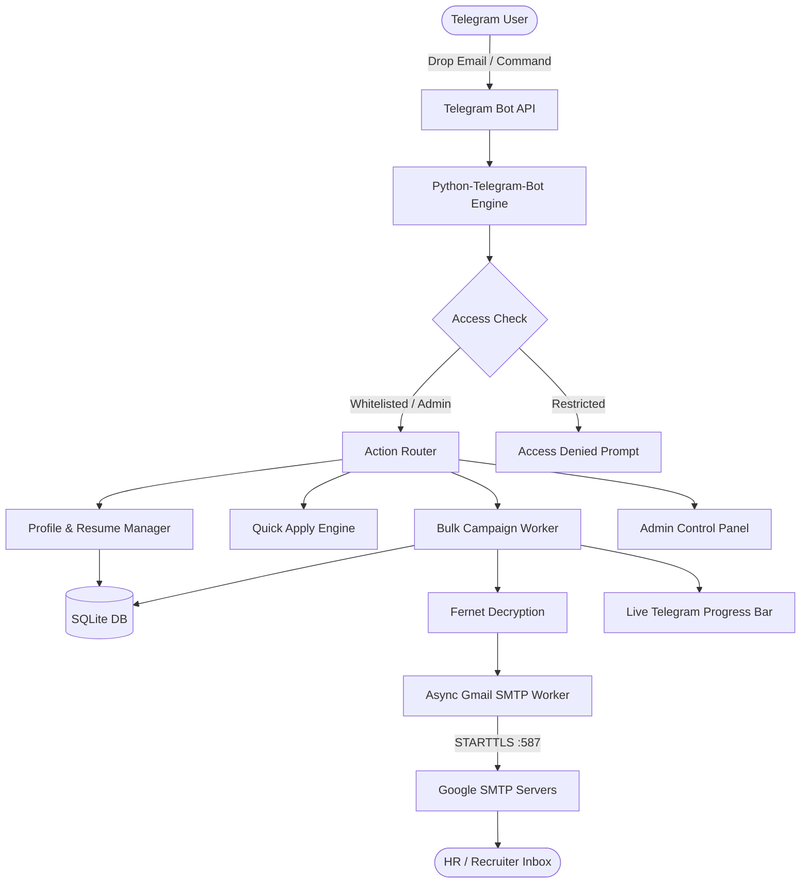

<div align="center">

# 📬 MailSenderBot

### Automated Job Application & Cold Email Bot for Telegram

[](https://www.python.org/)
[](https://github.com/python-telegram-bot/python-telegram-bot)
[](https://sqlite.org/)
[](https://cryptography.io/)
[](LICENSE)

<p align="center">
  <b>Organize tailored resumes, compose dynamic cover letters, paste recruiter emails directly in chat, and dispatch personalized cold job applications with safe anti-spam rate limiting.</b>
</p>

[Key Features](#-key-features) •
[Quick Start](#-quick-start-guide) •
[Interactive Workflow](#-interactive-workflow) •
[Architecture](#-architecture--design) •
[Admin Panel](#-in-telegram-admin-panel) •
[Security](#-security--encryption)

---

</div>

## 📖 Overview

**MailSenderBot** is a production-grade Telegram bot tailored for software engineers, job hunters, and freelancers. It automates sending personalized cold job applications to HRs and recruiters.

Instead of manually drafting emails, finding resumes, and sending one-by-one, you can:
- Store targeted profiles (e.g. *Frontend React*, *Backend Python*, *DevOps*), each with its own PDF resume attachment and personalized cover letter template.
- Drop an HR contact directly into chat (e.g. `recruiter@google.com, Google, Sarah`) and apply with **1 tap**!
- Blast batch applications with built-in humanized jitter delays to protect your Gmail reputation and prevent spam folder penalties.

---

## ✨ Key Features

### ⚡ 1-Tap "Quick Drop" Apply
- Paste single or multiple HR emails directly into chat at any time.
- The bot instantly extracts recipient details, checks for past duplicates, and presents inline buttons for all your job profiles.
- Tap your desired profile to send immediately with live delivery feedback!

### 📁 Multi-Profile & Resume Manager
- Store unlimited category profiles (e.g., *Full Stack Developer*, *Machine Learning Engineer*, *Cloud Architect*).
- Upload specific resumes (`.pdf`, `.docx`) directly in Telegram.
- Customize specific email subjects and cover letter templates per profile.
- View, download, or update resumes at any time.

### 📝 Dynamic Template Tags
Inject personalized variables into both the subject line and email body:
| Placeholder | Replacement Value | Fallback Default |
| :--- | :--- | :--- |
| `{company}` | Recruiter's company name | `"your company"` |
| `{name}` or `{hr_name}` | Recruiter's name | `"Hiring Manager"` |
| `{my_name}` | Your sender display name | Sender's profile name |
| `{email}` | Recruiter's email address | Recipient email |

### 📬 Multi-Format Contact Ingestion
- **Raw emails:** `recruiter1@meta.com, hr@stripe.com` or newline-separated.
- **Structured CSV:** `jobs@apple.com, Apple, Sarah`
- **File Upload:** Drop `.csv` or `.txt` contact sheets directly into Telegram.

### 🛡️ Smart Anti-Spam & Deliverability Engine
- **Jitter Delays:** Configurable inter-email pause (default 7s + randomized jitter) so outgoing traffic mimics authentic human typing and avoids Gmail rate-limits.
- **Duplicate Shield:** Detects if an HR address was already contacted previously, warning you before re-sending and offering a *"Send to New Only"* filter.
- **Live Visual Progress:** Real-time Telegram progress bar (`[████░░░░░░] 4/10 Sent`).

### 👑 In-Telegram Admin Panel (`/admin`)
- Control bot-wide access without touching server files or `.env`:
  - **Access Mode Toggle:** Switch between `🔒 Whitelist (Private)` and `🌐 Public (Open to anyone)`.
  - **Manage Whitelist:** Add/remove allowed Telegram User IDs directly in chat.
  - **Delivery Interval:** Adjust default delays across the bot on the fly.
  - **Broadcast Announcements:** Broadcast system messages to all registered users.
  - **Platform Statistics:** Global metrics on total users, profiles, and success rate.

### 📊 History Tracking & CSV Export
- Comprehensive logging of every application attempt with status (`SENT` / `FAILED`), timestamps, and error reasons.
- 1-click export of complete application history to an Excel/Google Sheets-compatible `.csv` file.

---

## 🏗 Architecture & Design



---

## 🚀 Quick Start Guide

### 1. Prerequisites
- **Python 3.9+**
- A **Telegram Bot Token** from [@BotFather](https://t.me/BotFather)
- A **Gmail Account** with 2-Step Verification enabled
- A **Google App Password** ([Generate here](https://myaccount.google.com/apppasswords))

---

### 2. Installation

```bash
# Clone the repository
git clone https://github.com/yourusername/MailSenderBot.git
cd MailSenderBot

# Create and activate virtual environment
python3 -m venv venv
source venv/bin/activate    # On Windows: venv\Scripts\activate

# Install dependencies
pip install -r requirements.txt
```

---

### 3. Configuration

Copy `.env.example` to `.env`:
```bash
cp .env.example .env
```

Edit `.env`:
```env
# Telegram Bot Token from @BotFather
TELEGRAM_BOT_TOKEN=123456789:ABCdefGhIJKlmNoPQRsTUVwxyZ

# Your Numeric Telegram User ID (Get it by messaging @userinfobot on Telegram)
ADMIN_USER_ID=6930069990

# 32-byte base64 encryption key (auto-generated if left blank)
ENCRYPTION_KEY=
```

---

### 4. Run the Bot

```bash
# Start polling
python bot.py
```

Console confirmation:
```
=======================================================
  🤖 MailSenderBot is ONLINE!
  👉 Username: @your_bot_username
  👉 Status: Ready to receive commands
=======================================================
```

---

## 📖 Interactive Workflow

### Step 1: Connect Gmail SMTP
1. In Google Account, turn on **2-Step Verification**.
2. Go to **Security ➔ App passwords** and generate a 16-character password for `MailSenderBot`.
3. In Telegram, open **⚙️ Gmail Settings**:
   - Set your Gmail address.
   - Enter your 16-character App Password (encrypted immediately).
   - Set your Sender Display Name (e.g. `Gaurav Sharma`).
   - Tap **🧪 Send Test Email** to verify connection.

### Step 2: Build Job Profiles
1. Tap **📁 Job Profiles ➔ ➕ Add New Profile**.
2. Give it a name (e.g. `Full Stack Engineer`).
3. Upload your Resume PDF directly into the chat.
4. Input your Subject template (e.g. `Application for Software Engineer Role - {my_name}`).
5. Input your Cover Letter template using dynamic tags:
   ```text
   Dear {name},

   I am writing to express my strong interest in software engineering opportunities at {company}.
   With hands-on experience in building scalable applications, I would love to contribute to your engineering team.

   Please find my resume attached for your review.

   Best regards,
   {my_name}
   ```

### Step 3: Instant Quick-Apply
Drop an email in the chat:
```text
recruiter@airbnb.com, Airbnb, Jessica
```
The bot instantly responds:
> 📬 **HR Contact Detected:** `recruiter@airbnb.com` *(Company: Airbnb, HR: Jessica)*  
> ⚡ **Select a profile below to send your application instantly:**  
> 
> `[ 🚀 Send with Full Stack Engineer ]`  
> `[ 🚀 Send with Backend Python ]`  
> `[ ❌ Dismiss ]`

Tap the profile button and your email is dispatched with the resume attachment!

---

## 🤖 Bot Commands

| Command | Description | Permission |
| :--- | :--- | :--- |
| `/start` | Open main dashboard and navigation menu | All Users |
| `/help` | Detailed setup and placeholder documentation | All Users |
| `/settings` | Configure Gmail, App Password, and delay | All Users |
| `/profiles` | Manage job categories, resumes, and cover letters | All Users |
| `/send` | Launch a bulk send campaign | All Users |
| `/history` | View application statistics and export CSV | All Users |
| `/admin` | Open super-admin management panel | Admin Only |
| `/cancel` | Cancel any active form or conversation | All Users |

---

## 🔒 Security & Encryption

- **Fernet Symmetric Cipher:** All user Google App Passwords are encrypted before writing to SQLite using AES-128-CBC with PKCS7 padding and HMAC-SHA256 authentication.
- **Multi-Tenant Isolation:** All profiles, resumes, and logs are segregated by Telegram User ID (`user_id`). Users cannot access or view another user's data.
- **Ephemeral Input:** Password messages typed by the user in chat are immediately deleted from Telegram history once encrypted.

---

## 🗄️ Database Schema

The bot uses an asynchronous SQLite database (`data/bot.db`):

- `users`: Stores user profile settings, encrypted credentials, and preferences.
- `profiles`: Stores job categories, subject templates, cover letters, and resume paths.
- `applications`: Complete dispatch audit trail (recipient, status, timestamps, error logs).
- `allowed_users`: Whitelisted Telegram IDs for private mode access.
- `system_settings`: Platform-wide configurations (access mode, default delays).

---

## 🧪 Testing

The repository includes a comprehensive unit test suite covering contact parsing, templating, cryptographic functions, multi-user isolation, and admin authorization.

```bash
# Run unit tests
./venv/bin/python -m unittest tests/test_core.py
```

---

## 📦 Production Deployment (24/7 Hosting)

### Using Systemd (Ubuntu/Debian)

1. Create a service file:
   ```bash
   sudo nano /etc/systemd/system/mailsenderbot.service
   ```

2. Add configuration:
   ```ini
   [Unit]
   Description=MailSenderBot Service
   After=network.target

   [Service]
   Type=simple
   User=ubuntu
   WorkingDirectory=/home/ubuntu/MailSenderBot
   ExecStart=/home/ubuntu/MailSenderBot/venv/bin/python bot.py
   Restart=always
   RestartSec=5

   [Install]
   WantedBy=multi-user.target
   ```

3. Enable and start:
   ```bash
   sudo systemctl daemon-reload
   sudo systemctl enable mailsenderbot
   sudo systemctl start mailsenderbot
   ```

---

## 📄 License

This project is licensed under the **MIT License** — see the [LICENSE](LICENSE) file for details.
# job-hunter
